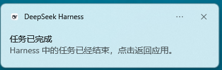

# Firefly · dsh-firefly

English | [中文](README.zh.md)

Windows task alerts, taskbar progress and composer history for the **DeepSeek Harness desktop app** — merged into one
install, with a switch for each feature.



Firefly is one DSH plugin bundle that does two things, and lets you turn either one off without disabling the other:

1. **Task alerts** — a native Windows notification when a task finishes or waits for you, plus taskbar progress while
   it runs.
2. **Composer history** — `↑` / `↓` in the message editor walks through the messages you already sent in this session.

Firefly replaces the two earlier plugins `attention-notify` and `dsh-desktop-extras`. Install it once; the two features
live in one row and are switched from **Settings → General**.

## What you get

| When | What happens |
| --- | --- |
| Any agent starts running | The taskbar button shows an indeterminate progress animation |
| The last agent goes idle | Progress is cleared, and about 0.6 s later a "Task finished" toast appears |
| A tool call waits for approval (`approval/request`) | A "Approval needed" toast appears, naming the tool |
| The agent asks you a question (`user-questions/request`) | An "Answer needed" toast appears, with the question header |
| You press `↑` in an empty composer on its first line | The newest message you sent in this session is recalled |
| You keep pressing `↑` / `↓` | You walk further back / forward; `↓` past the newest restores your draft |

Toasts appear only while the window is **minimized, hidden, or unfocused** — Firefly never interrupts you while you are
looking at the app. Clicking a toast restores and foregrounds the window (best effort: Windows decides whether a program
may take the foreground).

Composer history only takes over `↑` on the editor's **first line** and `↓` on its **last line**, so moving the caret
around a multi-line draft still works. It backs off while a popup (slash menu, `@` picker, …) is open, during IME
composition, and when Ctrl/Alt/Meta/Shift is held.

## Requirements

- The **desktop app** (Electron) on Windows 10/11 for the toasts, the taskbar progress and the window restore.
- Composer history works on any platform and in a plain browser window.
- A managed DSH profile — the desktop app provides one, or use `dsh` with `--profile`.

## Install

From the desktop app: **Plugins** → **Add plugin** → paste this directory's absolute path (or the repository URL), then
install.

From a terminal:

```powershell
dsh plugin --profile desktop add "C:\path\to\dsh-firefly"
# or straight from GitHub
dsh plugin --profile desktop add https://github.com/<you>/dsh-firefly
```

Through an agent, with the plugin manager tool:

```text
plugin_manager install_bundle C:\path\to\dsh-firefly
```

Installation links the package into the profile, adds `dsh-firefly` to `dsh.profile.bundles`, and inserts the `firefly`
row. Remove it again with:

```powershell
dsh plugin --profile desktop remove dsh-firefly
```

## Turning a feature on or off

Open **Settings → General**. Firefly adds two rows there:

| Row | Turns off |
| --- | --- |
| Task alerts | Toasts, the click-to-restore request, and taskbar progress |
| Composer history | The `↑`/`↓` history in the composer |

Each switch takes effect immediately in every open window and is remembered across restarts. The state is stored in
`<DSH_HOME>/firefly/settings.json` (usually `%USERPROFILE%\.dsh\firefly\settings.json`):

```json
{
  "alerts": true,
  "history": true
}
```

Turning both off is equivalent to having the plugin installed but silent. To remove it from the app entirely, switch the
plugin **off** on its page under **Plugins**, or uninstall it.

If another notification or input-history plugin is active — for example the older `input-history-arrows` — turn one of
them off instead of letting both answer the same keystroke.

## Configuration (optional)

The row config in the profile's `cordis.patch.yml` may seed the defaults:

```yaml
- id: firefly
  name: 'dsh-firefly'
  config:
    alerts: true
    history: true
    notifyOnDone: true
    notifyOnApproval: true
    notifyOnQuestion: true
    taskbarProgress: true
    doneDelayMs: 600
```

| Key | Default | Meaning |
| --- | --- | --- |
| `alerts` | `true` | Master switch for toasts, taskbar progress and focus requests |
| `history` | `true` | Master switch for the composer history |
| `notifyOnDone` | `true` | Announce that every agent went idle |
| `notifyOnApproval` | `true` | Announce a tool call waiting for approval |
| `notifyOnQuestion` | `true` | Announce a pending user question |
| `taskbarProgress` | `true` | Show the indeterminate taskbar progress while an agent runs |
| `doneDelayMs` | `600` | Wait this long for a follow-up run before calling the task finished |

The **Task alerts** and **Composer history** switches in Settings own `alerts` and `history`; once you use them, the
saved file wins over the row config. The remaining keys stay under the patch.

## How it works

```
Host half (index.js)                          Client half (client.js)
  agent/status ─────────┐                       ┌─ SSE /firefly/events ─→ toast when unfocused
  approval/request ─────┼─ /firefly/events      │
  user-questions/request┘                       ├─ Settings → General rows ─→ POST /api/firefly.settings
  taskbar ─→ helper/taskbar.ps1 (ITaskbarList3) │
  switches ─→ <DSH_HOME>/firefly/settings.json  └─ conversation.input.left ─→ ↑/↓ history
```

- The **Host half** runs in DSH's plain Node process and has no `BrowserWindow`, so the taskbar button is addressed by
  the window handle of the Electron main process (the Host's parent process). `helper/taskbar.ps1` starts once per state
  change (about 0.6–1.5 s), calls `ITaskbarList3::SetProgressState` or restores the window, and exits. It never stays
  resident.
- The event stream is a top-level `webServer` route (`/firefly/events`), not a `/api` Fetch route. The shared `/api`
  channel drains every in-flight response before a desktop update may install, so an endless `/api` stream would hold
  that drain until its 10 s deadline and fail every install. Like DSH's own `/plugins/events`, a top-level route stays
  out of that admission set; it fences itself to loopback callers instead of the `/api` cookie.
- `approval/request` and `user-questions/request` are waterfalls: the first listener that returns claims the request and
  the rest never run. The controller UI registers before any profile plugin, so Firefly's observers are prepended and
  always delegate with `next()`.
- The **Client half** streams the route with `fetch` (through the shell transport when one provides `fetch`), falling
  back to `EventSource` only when `fetch` is unavailable; it keeps a 25 s heartbeat and reconnects after 70 s of silence.
  It renders the two Settings rows, and it gates both features on the switches the Host reports — the Host is the one
  source of truth, so the switches and the actual behaviour can never disagree.

## Debugging

In the page console:

```js
window.__firefly
// {
//   version,
//   features: { alerts, history },
//   alerts: { received, lastKind, errors },
//   history: { mounted, props, history, phase, lastKey, lastResult, errors },
//   settings: { loaded, saving, lastSavedAt, errors }
// }
```

- `alerts.received` is not growing: the SSE stream is not connected, or the Host never broadcast.
- `history.mounted: false`: the composer slot entry has not rendered (is the plugin enabled and a conversation open?).
- `history.lastResult` names why a key press was skipped — `skip:feature-off`, `skip:popup`, `skip:not-first-line`, …
- `settings.errors` collects failed reads and writes.

## Limits

- Toasts, taskbar progress and window restore are **Windows only**. Composer history is platform independent.
- The taskbar progress only reaches an Electron desktop window; under the `dsh` CLI no window is found and the helper
  silently exits.
- Windows Focus Assist, or the app's notification switch being off, swallows the toast; the taskbar progress is
  unaffected.
- If Windows refuses to hand over the foreground, a toast click only flashes the taskbar button.

## License

[MIT](LICENSE)
